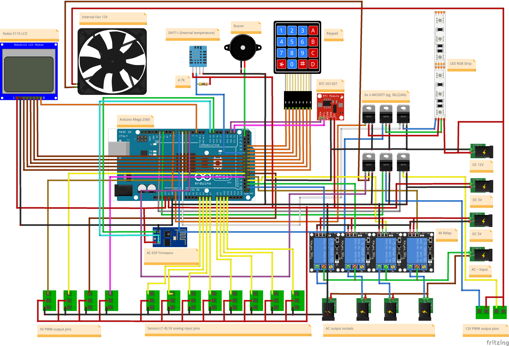

# AquariumController

An aquarium controller built around an **Arduino Mega 2560** and an **ESP32 or ESP8266**. The Mega runs the sensors, outputs, clock and local interface. The ESP provides the web panel, MQTT, Home Assistant discovery, Wi-Fi, NTP and OTA through **ArdPortal**.

## Project layout

| Directory | Contents |
| --- | --- |
| `AC-ATMEGA/` | Mega 2560 firmware, hardware drivers and controller tests |
| `AC-ESP/` | ESP firmware, ArdPortal integration, panel definitions and bridge tests |
| `Fritzing/` | Editable wiring drawing and PNG preview |

## Wiring diagram



[Download the editable Fritzing project](Fritzing/AquaController.fzz).

The drawing illustrates the hardware layout. Use the pin table below for the current firmware assignments; the fan has recently moved from D3 to D4.

## Features

- RGB lighting with manual colors, a custom RGB color, wave effects and smooth transitions.
- LED brightness from 0–100%, mapped to 16-bit PWM; 100% produces a constant high output.
- Up to four relays and six independent 16-bit PWM outputs.
- Manual control, time-of-day scheduling, threshold/hysteresis control and PWM PID control.
- One analog input per threshold or PID controller, with calibration and filtered measurements.
- A shared schedule for lighting, relays and PWM, with either daily times or separate weekday/weekend times.
- DHT11 temperature and humidity readings, temperature alarms and temperature-controlled cooling.
- DS1307 RTC support, UTC synchronization from the ESP and configurable local-time rules.
- Nokia 5110 display, 4×4 keypad and local contrast adjustment.
- Active-alarm diagnostics, including the three most recently activated alarms that are still active.
- Configurable buzzer behavior and permission to sound during each time-of-day phase.

The Portal and Home Assistant use the same field definitions. All channels of each output/input type share one panel page. Field visibility depends on the selected control mode and enabled hardware.

## Hardware pin assignments

| Function | Mega pins |
| --- | --- |
| RGB: red, green, blue | D6, D7, D8 |
| PWM outputs: 12 V channels 1–2 | D11, D12 |
| PWM outputs: channels 1–4 | D5, D44, D45, D46 |
| Fan, 8-bit PWM | **D4** |
| Nokia backlight, 16-bit PWM | D2 |
| Nokia SCE, RESET, DC, SDIN, SCLK | D42, D40, D38, D36, D34 |
| Relays 1–4 | D47, D49, D51, D53 |
| Analog inputs 1–8 | A4–A11 |
| DHT11 data | D32 |
| Buzzer | D22 |
| Keypad rows | D43, D41, D39, D37 |
| Keypad columns | D35, D33, D31, D29 |
| RTC SDA / SCL | D20 / D21 |
| ESP UART TX3 / RX3 | D14 / D15 |

D3 is available for an additional 16-bit PWM channel. D13 is intentionally unused because it can toggle during boot/upload. The firmware currently controls RGB, without a white channel.

RGB, the six PWM outputs and the display backlight use a range of **0–65535** at approximately 244 Hz. The fan uses standard **0–255** PWM on D4 without changing Timer0 timing.

### Mega–ESP connection

Use **115200 baud, 8N1**, cross TX/RX and connect a common ground:

| Mega | ESP32 | ESP8266 / ESP-01 |
| --- | --- | --- |
| TX3, D14 | RX2, GPIO16 | RX, GPIO3 |
| RX3, D15 | TX2, GPIO17 | TX, GPIO1 |
| GND | GND | GND |

Mega TX uses 5 V logic; adapt that signal to 3.3 V for the ESP RX input. Supply the ESP according to its board requirements. USB diagnostics use separate serial ports: Mega `Serial`, ESP32 `Serial`, or ESP8266 `Serial1` TX on GPIO2.

## Configuration and persistence

**ArdPortal stores persistent settings in ArdFS on the ESP.** There is no duplicate controller configuration in NVS or Mega EEPROM. The Mega receives enabled features and settings over UART at startup and validates them before enabling outputs. After successful initialization, it can continue operating from its RAM configuration if the ESP disconnects.

The Mega stores only the display contrast locally in EEPROM. Active alarms and temporary output overrides are not persistent settings.

The combined **LED: Status** light control exposes on/off, current brightness and Custom Color:

- Custom Color is saved whenever changed. An RGB edit immediately overrides the displayed color without changing the saved manual/scheduled color selection.
- Current brightness is saved only in manual mode.
- In schedule mode, current brightness can be changed temporarily; the next phase applies its scheduled brightness.
- Editing a phase's configured brightness does not immediately change current brightness, even while that phase is active.
- Manual output-state overrides expire when the control mode demands a new state or a new schedule phase starts.

Configuration writes are asynchronous. Allow the pending ArdFS save to finish before disconnecting power. A visible control update or UART acknowledgement alone does not prove that flash persistence has completed.

## Selecting hardware features

Edit the definitions at the beginning of `AC-ESP/AC-ESP.ino`. Counts of zero disable the corresponding group. The Mega firmware supports every group and receives the enabled feature manifest from the ESP.

| Definition | Current value | Supported values |
| --- | ---: | --- |
| `AC_RELAY_COUNT` | 4 | 0–4 |
| `AC_PWM_COUNT` | 0 | 0–6 |
| `AC_INPUT_COUNT` | 0 | 0–8 |
| `AC_ENABLE_DHT` | 1 | 0 or 1 |
| `AC_ENABLE_RTC` | 1 | 0 or 1 |
| `AC_ENABLE_BUZZER` | 1 | 0 or 1 |
| `AC_ENABLE_FAN` | 1 | 0 or 1 |

RGB lighting, the software clock and scheduling are always available. Without analog inputs, threshold/PID controls disappear. The fan requires DHT. With DHT enabled and the fan disabled, a DHT page replaces the fan page. Diagnostics is available when analog inputs, DHT or RTC are enabled. Existing Home Assistant entities are not automatically deleted when features are disabled.

### ArdPortal build switches

These definitions are also at the top of `AC-ESP.ino`. They select library modules rather than Mega hardware. Keep the control types required by the panel enabled.

| Definition | Current value | Purpose |
| --- | ---: | --- |
| `ARDPORTAL_ENABLE_DYNAMIC_PAGES` | 1 | Application pages |
| `ARDPORTAL_ENABLE_DEPENDENCIES` | 1 | Mode-dependent field visibility |
| `ARDPORTAL_ENABLE_HA` | 1 | Home Assistant discovery |
| `ARDPORTAL_ENABLE_CONSOLE` | 1 | Web console |
| `ARDPORTAL_ENABLE_CONSOLE_MESSAGES` | 1 | Application message log |
| `ARDPORTAL_ENABLE_MQTT` | 1 | MQTT connection and commands |
| `ARDPORTAL_ENABLE_MQTT_TLS` | 0 | TLS support; currently disabled |
| `ARDPORTAL_ENABLE_OTA` | 1 | Firmware upload through the portal |
| `ARDPORTAL_ENABLE_CONTROLS` | 0 | Disable the blanket selection of every control type |
| `ARDPORTAL_ENABLE_CONTROL_SLIDER`, `_TEXT`, `_SELECT`, `_EDIT`, `_SWITCH`, `_DATE`, `_TIME`, `_LIGHT` | 1 | Enable each control type used by this project; each suffix follows `ARDPORTAL_ENABLE_CONTROL` |
| `ARDPORTAL_ENABLE_CONTROL_BINARY_SENSOR` | 0 | Binary-sensor control implementation |

`MEGA_SERIAL` selects `Serial2` on ESP32 and `Serial` on ESP8266. `DIAGNOSTIC_SERIAL` selects `Serial` on ESP32 and `Serial1` on ESP8266. The corresponding `_NAME` definitions provide diagnostic labels. `MEGA_SERIAL_BAUD` and `DIAGNOSTIC_SERIAL_BAUD` are constants set to 115200; `SERIAL_DIAGNOSTICS_ENABLED` is currently `true`.

### Mega build settings

Hardware pins are defined in `AC-ATMEGA.ino`; their current assignments are listed above. The following definitions affect acquisition, timing and output resolution:

| Definition | Current value | Purpose |
| --- | ---: | --- |
| `DEBUG_LEVEL` | 0 | Disable legacy debug output; USB diagnostics remain available |
| `PWM_MAX`, `LED_PWM_MAX` | 65535 | Full-scale 16-bit output value |
| `LED_BRIGHTNESS_MAX` | 100 | User-facing brightness percentage |
| `FAN_PIN`, `FAN_PWM_MAX` | 4, 255 | Fan output and 8-bit full scale |
| `LCD_BACKLIGHT_ACTIVE_LOW` | 0 | Backlight polarity: 0 lights with HIGH, 1 with LOW |
| `ANALOG_CONTROL_INTERVAL_MS` | 100 | Analog acquisition and regulation cycle |
| `SENSOR_ADC_SAMPLES` | 10 | Samples collected per ADC result |
| `SENSOR_PUBLISH_INTERVAL_MS` | 1000 | Minimum automatic analog telemetry interval |
| `SENSOR_MAX_AGE_MILLIS` | 500 | Maximum usable analog-reading age |
| `TELEMETRY_MIN_INTERVAL_MS` | 5000 | General changed-value publication throttle used by output reporting |
| `CLOCK_SYNC_INTERVAL_MILLIS` | 10000 | Clock synchronization service interval |
| `CLOCK_MAX_NTP_STEP` | 300 | Time-correction validation limit, in seconds |
| `SENSORS_COUNT`, `RELAYS_COUNT`, `PWMOUTPUTS_COUNT` | 8, 4, 6 | Firmware capacities; select active counts on the ESP instead |

The remaining Mega definitions describe internal mode IDs, field IDs and RAM configuration layout. They are implementation constants, not feature-selection switches. The `SERIAL_TX_BUFFER_SIZE` and `SERIAL_RX_BUFFER_SIZE` declarations in the sketch are 64; the Arduino core is not patched by this project.

## Required libraries

| Target | Library | Version used for verification | Purpose |
| --- | --- | --- | --- |
| Mega | Time | 1.6 | Software timekeeping and date conversion |
| Mega | Timezone | 1.2.4 | Local-time and daylight-saving rules |
| Mega | Keypad | 3.1.1, with the symbol rename below | Matrix keypad |
| ESP32 / ESP8266 | [ArdPortal](https://github.com/rkubera/ArdPortal) | 0.7.8 | HTTP panel, Wi-Fi, MQTT, Home Assistant, OTA, ArdFS and ArdJSON |

ArdFS and ArdJSON are supplied by ArdPortal, not separate configuration stores added by this project. Wi-Fi, DNS, networking and firmware-update support come from the selected ESP Arduino core. No separate PubSubClient, LittleFS, DHT, RTC, Nokia display or QuickStats library is required: the Mega drivers are included in this repository.

For Keypad, rename the `OPEN` and `CLOSED` definitions to `KBD_OPEN` and `KBD_CLOSED` and update their uses in the Keypad library headers/source. The sketch expects those names to avoid macro collisions.

Verified core versions: Arduino AVR **1.8.8** and ESP32 **3.3.12**. Select the ESP8266 core when building for ESP-01/ESP12F; verification has also used ESP8266 **3.1.2**.

## Build and setup

1. Install the Arduino AVR core for Mega 2560 and the appropriate ESP32 or ESP8266 core.
2. Install **ArdPortal** and its dependencies, plus **Time**, **Timezone** and **Keypad** for the Mega. The current Mega code uses `KBD_OPEN`/`KBD_CLOSED`: the Keypad library must provide those names, as described in the sketch's include comment.
3. Open `AC-ATMEGA/AC-ATMEGA.ino`, select **Arduino Mega or Mega 2560**, and upload it.
4. Open `AC-ESP/AC-ESP.ino`, select the appropriate ESP board and flash layout, and upload it.
5. Connect the controller UART and configure Wi-Fi/MQTT through ArdPortal. Configure the desired control modes, schedules, sensor calibration and timezone rules.

**ESP32 is recommended when all features are enabled**, including all relay, PWM and analog-input channels, DHT, RTC, buzzer and fan support. ESP8266 is supported, but available heap and flash/OTA space constrain larger configurations. This repository does not bundle ArdPortal.

Example Arduino CLI builds:

```sh
arduino-cli compile --fqbn arduino:avr:mega AC-ATMEGA
arduino-cli compile --fqbn esp32:esp32:esp32 AC-ESP
# Alternatively:
arduino-cli compile --fqbn esp8266:esp8266:generic AC-ESP
```

## Communication and diagnostics

The controller UART uses binary numeric field IDs, COBS framing, CRC32, acknowledgements, retransmission and boot/session identifiers. Both firmwares must use the same generated dictionary. Update both when the protocol or dictionary changes. This is a custom protocol, not Tuya wire-format compatibility.

Only the ESP handles MQTT. It maps controller fields to `stat/<device>/<field>` and `cmnd/<device>/<field>`. The legacy `POWER1`/`POWER2` bridge is removed. The LED uses its combined light control; relay 3 uses the same mechanism as the other relays.

Analog acquisition and regulation run every 100 ms; automatic MQTT input readings are limited to once per second. Temperature and humidity are published no more than once per minute. Startup/reconnect snapshots and explicit read requests are separate from these limits.

Use **Console → Messages** for panel registration and application logs, the Diagnostics page for active alarms, and USB serial diagnostics for timing and UART counters. Missing or invalid RTC readings raise an alarm when RTC support is enabled; there is no separate `ClockRtcStatus` HA/MQTT entity.

## Development and tests

Host tests use Python 3 and a C++ compiler. Typical checks:

```sh
python3 AC-ATMEGA/tests/run_link_tests.py
python3 AC-ATMEGA/tests/run_rtc_tests.py
python3 AC-ATMEGA/tests/run_alarm_history_tests.py
python3 AC-ATMEGA/tests/run_led_pwm_tests.py
python3 AC-ESP/tests/pacing_test.py
python3 AC-ESP/tests/light_storage_test.py
```

Regenerate panel definitions first, then the shared wire dictionary when changing fields:

```sh
python3 AC-ESP/tests/generate_panel.py
python3 AC-ESP/tests/generate_wire.py
```

Additional protocol notes and specialized tests remain alongside each firmware.

## License

[Original AquariumController license](License.txt), unchanged from the previous repository version:

You may use, modify, fork and redistribute the project free of charge for **non-commercial use only**. For commercial use, contact the author. All rights reserved.

Third-party components retain their own license notices, including the PID implementation in `AC-ATMEGA/Control.ino`.

Author: Radek Kubera ([rkubera](https://github.com/rkubera)).
